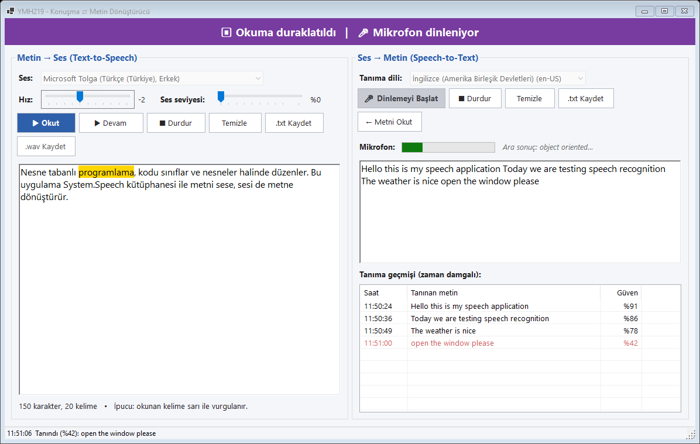
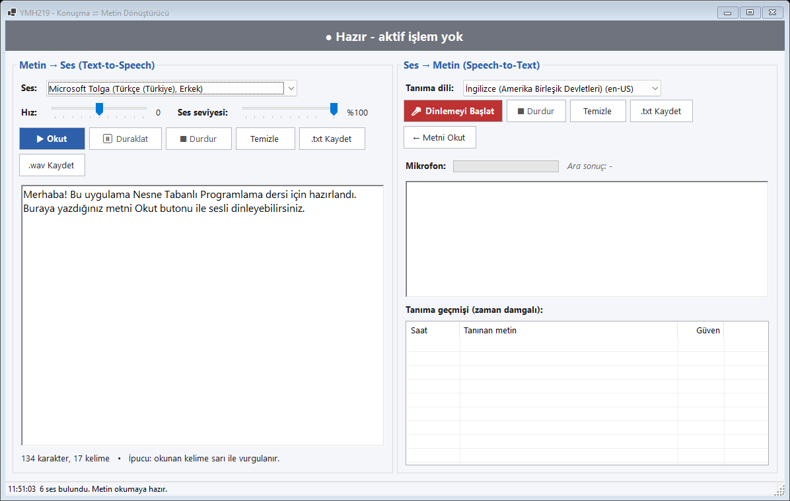
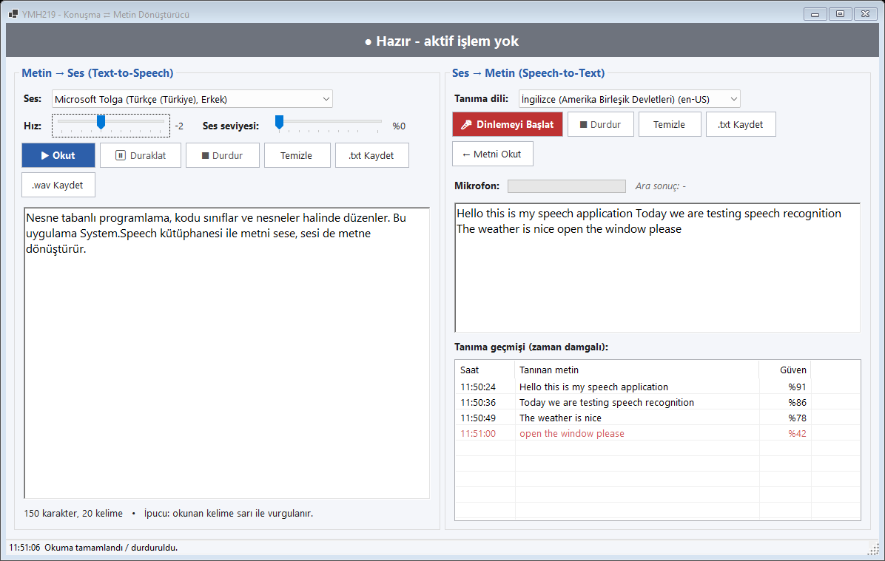

# YMH219 - Speech-to-Text ve Text-to-Speech Uygulaması

Nesne Tabanlı Programlama (YMH 219) dersi ek uygulama ödevi kapsamında geliştirilmiş, **C# / .NET Windows Forms** ile yazılmış, ses ve metin arasında çift yönlü dönüşüm yapan masaüstü uygulaması.

- **Metin → Ses:** Kutuya yazılan metin seçilen sesle sesli okunur. Okunan kelime anlık olarak sarı renkle vurgulanır.
- **Ses → Metin:** Mikrofondan gelen konuşma metne çevrilir. Her cümle zaman damgası ve güven skoruyla listelenir.

## Ekran Görüntüleri

**Okuma (duraklatıldı, kelime vurgulu) ve mikrofon dinleme aynı anda**


| Başlangıç ekranı | Tanıma sonuçları ve geçmiş |
|:---:|:---:|
|  |  |

## Kullanılan Teknolojiler / NuGet Paketleri

- C# 14 / .NET 10 (`net10.0-windows`)
- Windows Forms
- **[System.Speech](https://www.nuget.org/packages/System.Speech) 10.0.0** (NuGet)
  - `System.Speech.Synthesis.SpeechSynthesizer` → metin okuma
  - `System.Speech.Recognition.SpeechRecognitionEngine` + `DictationGrammar` → konuşma tanıma

## Kurulum ve Çalıştırma

**Visual Studio ile:**
1. Depoyu klonlayın: `git clone https://github.com/Omerdoganse/YMH219-SpeechApp.git`
2. `YMH219-SpeechApp.sln` dosyasını Visual Studio 2022 (17.14+) / 2026 ile açın. NuGet paketi otomatik geri yüklenir.
3. `F5` ile çalıştırın.

**Komut satırı ile:**
```bash
cd YMH219-SpeechApp
dotnet run --project SpeechApp
```

> .NET 10 SDK ve Windows gereklidir (System.Speech yalnızca Windows'ta çalışır).
> Konuşma tanıma için bir mikrofon ve Windows'ta **Ayarlar → Gizlilik ve güvenlik → Mikrofon** bölümünde masaüstü uygulamalarına izin verilmiş olmalıdır.

## Kullanım

**Metin → Ses**
1. Sol taraftaki kutuya metni yazın.
2. **Ses** listesinden bir ses seçin. Türkçe ses (ör. *Microsoft Tolga*) kuruluysa otomatik seçilir.
3. **Hız** (-10 ile +10 arası) ve **Ses seviyesi** (%0 ile %100 arası) ayarlarını yapın.
4. **▶ Okut** ile okutun. **⏸ Duraklat / ▶ Devam** ve **■ Durdur** ile kontrol edin, **Temizle** ile metni silin.
5. **.txt Kaydet** metni, **.wav Kaydet** okunuşu ses dosyası olarak kaydeder.

**Ses → Metin**
1. **Tanıma dili** listesinden kurulu bir dili seçin.
2. **🎤 Dinlemeyi Başlat**'a basın ve konuşun. Konuşma sırasında *Ara sonuç* ve mikrofon seviyesi görünür.
3. Tanınan her cümle metin alanına eklenir ve **Tanıma geçmişi** tablosuna saat ve güven skoruyla yazılır. Güveni %50'nin altındaki sonuçlar kırmızı gösterilir.
4. **■ Durdur** ile dinlemeyi bitirin. **.txt Kaydet** zaman damgalı kaydı dosyaya yazar, **← Metni Okut** tanınan metni sol bölüme aktarıp sesli okur.

## Temel Özellikler

- Text-to-Speech: Okut, Duraklat/Devam, Durdur ve Temizle.
- Kurulu seslerin listelenmesi ve **ses seçimi**, **okuma hızı** ve **ses seviyesi** ayarı.
- Okunan kelimenin **anlık vurgulanması** (`SpeakProgress` olayı).
- Metni **.txt**, okunuşu **.wav** olarak kaydetme.
- Speech-to-Text: mikrofondan **serbest dikte**, ara sonuç gösterimi ve mikrofon seviye çubuğu.
- Tanıma sonuçlarının **zaman damgası ve güven skoruyla** listelenmesi ve `.txt` dosyasına kaydedilmesi.
- **Aktif işlem göstergesi:** üstteki renkli şerit hangi işlemin sürdüğünü gösterir (*Hazır* gri, *okunuyor* yeşil, *duraklatıldı* turuncu, *dinleniyor* kırmızı, ikisi birden mor). Alttaki durum çubuğu her işlemi saatiyle yazar.
- **Hata kontrolleri:** uygulama çökmez, kullanıcıya anlaşılır Türkçe mesaj gösterilir:
  - Mikrofon yok veya erişim izni kapalı → *"Mikrofon bulunamadı veya erişilemiyor..."*
  - Konuşma tanıyıcı / dil paketi yok → dil paketi yükleme yönlendirmesi
  - Ses bulunamadı, hoparlör / ses servisi yok → sentezleyici başlatılamadı uyarısı
  - Boş metin okutma, okuma sürerken .wav oluşturma, dosya yazma hataları

## Proje Yapısı ve Sınıf Tasarımı

```
SpeechApp/
├── Program.cs
├── MainForm.cs                 # Ana form: düzen, aktif işlem göstergesi, ortak yardımcılar
├── MainForm.Tts.cs             # (partial) Metin → Ses bölümü
├── MainForm.Stt.cs             # (partial) Ses → Metin bölümü
├── UiFactory.cs                # Ortak görünümlü buton/etiket/panel oluşturma
├── Models/
│   ├── SpeechStates.cs         # TtsState (Idle/Speaking/Paused), SttState (Idle/Listening/Stopping)
│   ├── RecognitionEntry.cs     # Tanınan cümle: metin, güven skoru, zaman damgası
│   └── VoiceOption.cs          # ComboBox'ta gösterilen ses / dil seçeneği (record)
└── Services/
    ├── TextToSpeechService.cs  # SpeechSynthesizer sarmalayıcısı
    ├── SpeechToTextService.cs  # SpeechRecognitionEngine sarmalayıcısı
    ├── TextFileService.cs      # .txt kaydetme
    └── SpeechServiceException.cs # Kullanıcıya gösterilecek anlaşılır hata türü
```

- **Katmanlı tasarım:** Ses işlemleri form kodundan ayrılmış servis sınıflarındadır. Form yalnızca servislerin metotlarını çağırır ve olaylarını dinler.
- **Kapsülleme:** `SpeechSynthesizer` / `SpeechRecognitionEngine` nesneleri servislerin içinde `private` tutulur. `State` özellikleri dışarıdan değiştirilemez (`private set`), `Rate` ve `Volume` geçerli aralığa sınırlandırılır.
- **Olaylar (event):** `TextToSpeechService` → `StateChanged`, `WordSpoken`, `ErrorOccurred`. `SpeechToTextService` → `StateChanged`, `SpeechRecognized`, `HypothesisChanged`, `AudioLevelChanged`, `ErrorOccurred`. Form bu olaylarla arayüzü UI iş parçacığında (`BeginInvoke`) günceller.
- **Kaynak yönetimi:** Her iki servis `IDisposable` arayüzünü uygular. Form kapanırken okuma iptal edilir, mikrofon bırakılır ve motorlar `Dispose` edilir. Tanıma motoru her dinleme bitişinde serbest bırakılır.
- **Kalıtım:** `SpeechServiceException`, `Exception` sınıfından, `WordProgressEventArgs` ise `EventArgs` sınıfından türer.
- **Partial class:** Büyük form, okunabilirlik için iki bölüme ayrılmıştır.

## Bilinen Sınırlamalar / Geliştirme Notları

- `System.Speech` yalnızca Windows'ta çalışır.
- Konuşma tanıma yalnızca bilgisayarda **kurulu masaüstü (SAPI) tanıyıcılarıyla** çalışır. Geliştirme bilgisayarında yalnızca **İngilizce (en-US)** tanıyıcı bulunduğu için ekran görüntülerindeki tanıma örnekleri İngilizcedir. Türkçe tanıyıcı kuruluysa uygulama onu otomatik seçer.
- Serbest dikte doğruluğu mikrofon kalitesine, ortam gürültüsüne ve aksana bağlıdır. Düşük güvenli sonuçlar kırmızı gösterilir.
- Metin okuma, kurulu seslere bağlıdır (geliştirme bilgisayarında Türkçe *Microsoft Tolga* ve İngilizce sesler mevcuttur).
- Ekran görüntülerinde metin okuma gerçekten çalıştırılarak alınmıştır. Mikrofon dinleme ekranındaki tanıma satırları ise gösterim amacıyla örnek verilerle doldurulmuştur.

## Öğrenci Bilgileri

- **Ad Soyad:** Ömer Doğan
- **Öğrenci No:** 250541101
- **Ders:** Nesne Tabanlı Programlama (YMH 219)
